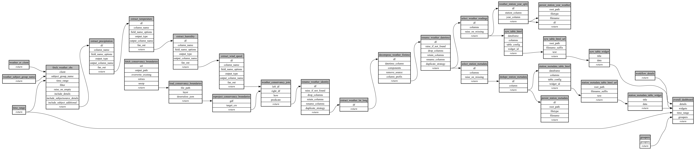

```
# AUTOGENERATED BY ECOSCOPE-WORKFLOWS; see fingerprint in README.md for details

```

```yaml
# fingerprint:
artifacts_sha256_basic: 8163b9eb3f51a15d0a24a718f4bf7cf810bc0ffa3e8faf8e60761afb6b87d575
artifacts_sha256_strict: ae51a7a5a4bb2205193cc87a2b75de5286f93cf80eee07fddd913106fda047e7
installed_requirements:
- channel: https://repo.prefix.dev/ecoscope-workflows/
  name: ecoscope-platform
  version: {version: ==2.15.1}
- channel: https://repo.prefix.dev/ecoscope-workflows-custom/
  name: ecoscope-workflows-ext-custom
  version: {version: ==0.1.0rc14}
- channel: https://repo.prefix.dev/ecoscope-workflows-custom/
  name: ecoscope-workflows-ext-ste
  version: {version: ==0.0.0rc1}
- channel: https://repo.prefix.dev/ecoscope-workflows-custom/
  name: ecoscope-workflows-ext-distance-sample-counts
  version: {version: ==1.0.2}
- channel: conda-forge
  name: pydeck
  version: {version: ==0.9.2}
- channel: conda-forge
  name: opentelemetry-sdk
  version: {version: ==1.45.1}
params_sha256: 657673c358696f94a81a79e9f9c1360892d193345f9affec35a903f1363b78bd
spec_sha256: a817aaf096db82990af731a281afdcc8c8a9afc35d903d70aa0ac2579a426712

```

# ecoscope-workflows-dsc-weather-workflow


